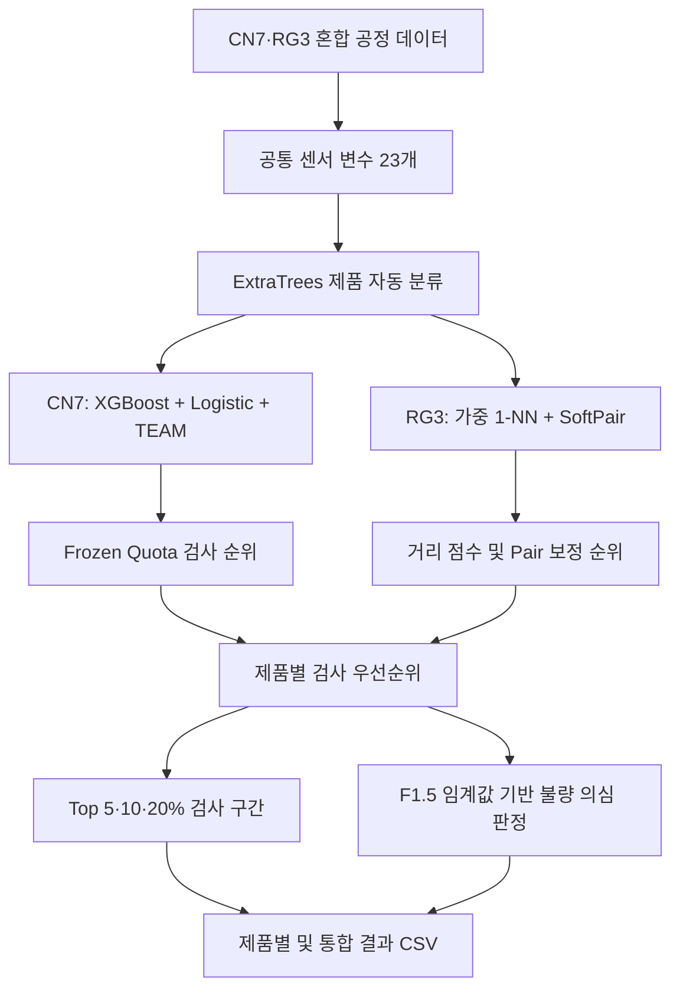

# KAMP 2026 | 사출성형 품질 예측 및 검사 우선순위 모델

2026 KAMP 제조 데이터 AI 모델 개발 경진대회 사출성형 부문에서 개발한 **CN7·RG3 제품별 불량 의심 예측 및 검사 우선순위 생성 프로젝트**입니다.

사출성형 공정의 시간·압력·속도·온도 등 23개 센서 변수를 활용해 제품을 자동으로 구분하고, 제품별 특성에 맞는 모델로 품질 위험을 평가합니다. 예측 결과는 정상/불량 의심 표시와 함께 검사 순위 및 검사 구간으로 제공하여, 한정된 검사 자원을 우선 확인할 제품에 배분할 수 있도록 구성했습니다.

## 개발 내용

- **센서 기반 제품 자동 분류:** CN7·RG3 혼합 입력을 ExtraTrees 분류기로 구분하고 해당 품질 모델에 연결했습니다.
- **CN7 앙상블 품질 모델:** 공정 변수 간 상호작용, 의사라벨을 활용한 반지도학습, 5개 시드 XGBoost 평균과 보조 모델을 결합했습니다.
- **검사 목록 보완 정책:** XGBoost가 낮게 평가했지만 보조 모델이 높게 평가한 후보를 일정 비율 포함하는 Frozen Quota 정책을 구현했습니다.
- **RG3 거리 기반 품질 모델:** 기존 불량 공정조건과의 가중 최근접 거리에 동일 센서·연속 기록 쌍의 보조신호를 결합했습니다.
- **품질 판정 및 검사 우선순위:** 제품별 순위를 산출하고 Top 5·10·20% 검사 구간과 F1.5 기준 이진 예측을 생성했습니다.
- **재현 및 검증 코드:** 모델 재학습, 예측 CSV 생성, 입력 보존·순위·판정 기준·기준 결과 일치 검증을 구성했습니다.

## 전체 처리 흐름



## 데이터

| 구분 | CN7 | RG3 |
| --- | ---: | ---: |
| 라벨이 있는 학습 데이터 | 1,211행 | 1,182행 |
| 학습 데이터의 불량 | 17건 | 25건 |
| 공식 무라벨 테스트 데이터 | 35,239행 | 35,941행 |

품질 정답은 `PassOrFail`이며, `0`은 정상, `1`은 불량입니다. 공식 테스트 데이터에는 이 정답이 없습니다.

모델이 사용하는 센서 변수는 다음과 같습니다. 원본의 `Clamp_Open_Position`은 모델 입력에서 제외합니다.

| 유형 | 사용 변수 |
| --- | --- |
| 공정 시간 | `Injection_Time`, `Filling_Time`, `Plasticizing_Time`, `Cycle_Time`, `Clamp_Close_Time` |
| 위치 | `Cushion_Position`, `Plasticizing_Position` |
| 속도·회전수 | `Max_Injection_Speed`, `Max_Screw_RPM`, `Average_Screw_RPM` |
| 압력 | `Max_Injection_Pressure`, `Max_Switch_Over_Pressure`, `Max_Back_Pressure`, `Average_Back_Pressure` |
| 온도 | `Barrel_Temperature_1`~`6`, `Hopper_Temperature`, `Mold_Temperature_3`, `Mold_Temperature_4` |

원본 첫 번째 열인 `Unnamed: 0`은 기록 ID입니다. 제품 분류 입력에는 사용하지 않으며, RG3의 SoftPair 보조신호 계산에 사용합니다.

## 모델 설계

### 1. 제품 자동 분류: ExtraTrees23

160개 트리로 구성한 ExtraTrees 분류기가 23개 공정 센서로 제품을 구분합니다. RG3 분류 점수가 0.5 이상이면 RG3 모델로, 미만이면 CN7 모델로 전달합니다.

선택된 제품의 분류 점수가 0.8 미만이거나 센서값이 제품 분류기의 학습 범위를 벗어나면 검토 대상으로 표시합니다. 기본 공식 테스트 실행 경로는 검토 대상이 발생할 경우 검증 단계에서 중단하도록 되어 있습니다.

추론 시 파일명·기록 ID·품질 정답은 제품 분류 피처로 사용하지 않습니다. 다만 분류기 학습에는 학습·공식 테스트 파일의 CN7/RG3 출처를 제품 라벨로 사용하므로, 제공 테스트에서의 분기 일치율을 새로운 생산 데이터의 독립 평가 성능으로 해석할 수 없습니다.

### 2. CN7: 반지도학습 앙상블과 Frozen Quota

압력 `S = Max_Switch_Over_Pressure`, 속도 `V = Max_Injection_Speed`, 시간 `F = Filling_Time`으로 `S×V`, `S×F`, `F×V`, `S×V×F` 상호작용 피처를 생성합니다.

| 구성 | 역할 |
| --- | --- |
| `XGB_SVF_SSL` | 상호작용 피처와 의사라벨로 학습한 XGBoost 5개 시드의 평균 점수로 기본 순위 생성 |
| `LOG_SV_SSL` | 표준화·Logistic Regression·의사라벨을 활용한 보조 점수 생성 |
| `TEAM_LX` | Logistic Regression과 XGBoost 점수를 1:1로 평균한 보조 점수 생성 |

CN7 공식 무라벨 데이터를 의사라벨 후보로 활용하며, 테스트의 실제 품질 정답을 사용하는 방식은 아닙니다.

Frozen Quota는 검사 범위를 상위 5% → 10% → 20%로 확대하면서, 각 단계에서 새로 추가되는 자리의 최대 20% → 30% → 20%를 보조 모델이 발견한 후보에 배정합니다. 나머지는 XGBoost 순위로 채우며, 이전 단계에서 선정한 행을 유지합니다. 이를 통해 기본 모델 중심의 순위를 유지하면서 보조 모델의 후보를 검사 목록에 반영합니다.

### 3. RG3: 가중 1-NN과 SoftPair

동일한 센서값을 가진 기록을 공정조건 단위로 묶고, 해당 조건에 불량이 하나라도 있으면 불량 참조 조건으로 사용합니다. 표준화한 센서에서 정상·불량 조건의 평균 차이로 변수별 거리 가중치를 계산합니다.

새 기록에서 가장 가까운 불량 참조 조건까지의 가중 유클리드 거리 `d`를 구하고, `1 / (1 + d)`를 기본 위험점수로 사용합니다.

SoftPair는 다음 조건을 모두 만족할 때 적용합니다.

- 23개 센서값이 모두 같은 기록이 입력 배치에 정확히 2개 존재
- 두 기록의 원본 ID가 연속

조건을 만족하면 학습 데이터에서 정한 위치 방향에 따라 점수에 `±0.125`를 보정합니다. 가중치 설정은 `alpha=1.0`입니다. 쌍이 성립하지 않는 행에는 보정하지 않습니다.

Pair 위치와 실제 금형 위치·불량 원인 사이의 물리적 관계는 확인되지 않았으며, 두 기록이 같은 배치에 들어와야 계산할 수 있습니다.

### 4. 검사 순위와 이진 품질 예측

제품별 최종 순위를 `1~N`으로 매기고, 다음 식으로 상대 우선순위 점수를 계산합니다.

```text
Priority_Score = 1 - (Inspection_Rank - 1) / max(N - 1, 1)
Predicted_PassOrFail = 1 if Priority_Score >= 제품별 임계값 else 0
```

| 제품 | F1.5 기준 임계값 |
| --- | ---: |
| CN7 | 0.9851239669421488 |
| RG3 | 0.7552921253175275 |

F1.5는 Precision보다 Recall에 더 큰 비중을 두는 지표입니다. 임계값은 기존 개발 데이터의 그룹 분리 OOF 결과에서 선택한 값을 사용합니다.

Top 5·10·20% 검사 구간과 이진 예측은 별도로 산출합니다. RG3는 임계값에 따른 불량 의심 범위가 상위 20%를 넘으므로, 해당 행을 `AFTER_TOP_20_PCT_FAIL_SUSPECT`로 표시합니다.

**`Priority_Score`는 배치 내 상대 순위이며 불량확률이 아닙니다.** 배치 구성에 따라 순위와 판정이 달라질 수 있고, 두 제품의 원점수도 서로 직접 비교할 수 없습니다. CN7의 `Model_Score`는 XGBoost 기본 점수이므로 보조 후보가 반영된 최종 검사 순위와 정렬 순서가 다를 수 있습니다.

## 파일 구조 및 파일별 설명

```text
KAMP_CN7_RG3_Submission/
├── README.md
├── requirements.txt
├── train_model.py
├── rebuild_f15_bundle.py
├── predict_test_data.py
├── verify_results.py
├── source_code/
│   └── f15_model.py
├── model/
│   └── KAMP_CN7_RG3_RiskPriority_F15_Threshold.joblib
├── training_data/
│   ├── CN7_training_data.csv
│   └── RG3_training_data.csv
├── test_data/
│   ├── CN7_test_data.csv
│   └── RG3_test_data.csv
├── test_prediction/
│   ├── CN7_test_data_predictions.csv
│   ├── RG3_test_data_predictions.csv
│   └── CN7_RG3_combined_predictions.csv
└── docs/
    └── RESULTS_GUIDE.md
```

### 루트 파일

| 파일 | 내용 |
| --- | --- |
| `README.md` | 프로젝트 목적, 개발 내용, 모델 구조, 데이터, 실행 방법 및 검증 범위 설명 |
| `requirements.txt` | NumPy, pandas, SciPy, scikit-learn, XGBoost, joblib 의존성 정의. scikit-learn `1.8.0`, XGBoost `3.1.3` 고정 |
| `train_model.py` | 입력 스키마 확인, CN7 상호작용 피처·의사라벨 학습·앙상블 학습, RG3 가중 거리·Pair 방향 학습, ExtraTrees 제품 분류기 학습 및 모델 번들 저장. 선택된 최종 설정을 다시 학습하며 개발 당시의 탐색·교차검증 전체를 반복하지 않음 |
| `rebuild_f15_bundle.py` | 재학습 번들의 모델명·피처·분류기 설정을 확인한 후, 제출 모델의 고정 F1.5 판정 정책을 연결. 새 모델에 대한 임계값 최적화는 수행하지 않음 |
| `predict_test_data.py` | 공식 테스트 두 파일을 제품별 내부 순서를 유지한 채 35~180행 블록으로 혼합하고 센서 기반 자동 분류·품질 추론 실행. 원래 순서 복원, 원본 센서값 보존, 제품별·통합 CSV 저장 및 출력 일관성 확인 |
| `verify_results.py` | 입력·출력 행 수와 센서값, 제품 분기, 순위 중복·누락, 순위 환산 점수, 임계값 기반 0/1 판정, 제품별·통합 결과 일치를 확인. 기본 제출 모델의 결과는 기준 순위 SHA-256 해시와도 대조 |

### `source_code/` — 추론 핵심 로직

`f15_model.py`는 모델을 이용해 점수와 판정을 산출하는 공통 모듈입니다.

| 주요 함수 | 내용 |
| --- | --- |
| `load_decision_bundle()` | joblib 번들을 불러오고 제품 분류·품질 모델·판정 정책 필수 키 확인 |
| `_auto_route()` | 센서 기반 제품 분류 및 낮은 분류 점수·학습 범위 이탈 표시 |
| `score_cn7()`, `_cn7_queue()` | CN7 모델 점수, Frozen Quota 최종 순위, 보조 후보 선정 정보 및 검사 구간 생성 |
| `_rg3_pair_position()`, `score_rg3()` | RG3 쌍 조건 판별, 가중 1-NN 점수 및 SoftPair 보정, 최종 순위 생성 |
| `score_dataframe()` | 제품별 모델 실행과 결과 통합, 고정 임계값을 적용한 품질 예측. `Product_Type`이 있으면 명시 제품을 사용하고 없으면 자동 분류 |
| `evaluate_labeled()` | 정답이 포함된 결과에 대해 Accuracy·Precision·Recall·F1·F1.5·F2·AP, 혼동행렬 및 Top-k 불량 포착률 계산 |

### `model/` — 제출 모델

`KAMP_CN7_RG3_RiskPriority_F15_Threshold.joblib`은 다음 항목을 하나로 묶은 추론용 모델 번들입니다.

- `product_gate`: 제품 분류기, 사용 피처 및 분류기 학습 범위
- `cn7_quality`: XGBoost·Logistic·TEAM 모델, 전처리 및 Frozen Quota 설정
- `rg3_quality`: 표준화기, 센서별 가중치, 불량 참조 최근접 이웃 모델 및 Pair 보정 설정
- `decision_policy`: 제품별 F1.5 임계값 및 점수 해석 정보

### `training_data/` — 라벨 학습 데이터

| 파일 | 내용 |
| --- | --- |
| `CN7_training_data.csv` | CN7 공정 기록과 `PassOrFail` 정답. CN7 품질 모델 및 제품 분류기 학습에 사용 |
| `RG3_training_data.csv` | RG3 공정 기록과 `PassOrFail` 정답. RG3 불량 참조 조건·거리 가중치·Pair 방향 및 제품 분류기 학습에 사용 |

### `test_data/` — 공식 무라벨 데이터

| 파일 | 내용 |
| --- | --- |
| `CN7_test_data.csv` | CN7 공식 무라벨 테스트 35,239행. 추론 입력이며 재학습 시 CN7 의사라벨 후보와 제품 분류기 학습에 활용 |
| `RG3_test_data.csv` | RG3 공식 무라벨 테스트 35,941행. 추론 입력이며 재학습 시 제품 분류기 학습에 활용 |

### `test_prediction/` — 예측 산출물

| 파일 | 내용 |
| --- | --- |
| `CN7_test_data_predictions.csv` | CN7 원본 순서를 유지한 센서값·제품 예측·품질 예측·검사 순위 35,239행 |
| `RG3_test_data_predictions.csv` | RG3 원본 순서를 유지한 센서값·제품 예측·품질 예측·검사 순위 35,941행 |
| `CN7_RG3_combined_predictions.csv` | 두 제품을 블록 단위로 혼합한 전체 결과 71,180행. 제품별 내부 순서와 각 제품 파일의 결과 유지 |

### `docs/` — 결과 해석 문서

`RESULTS_GUIDE.md`에는 출력 열의 의미, 제품별 판정 건수, 검사 구간별 수량, F1.5 검증 근거, 자동 검증 항목 및 데이터 분포 차이를 정리했습니다.

## 실행 방법

권장 환경은 **Python 3.12**입니다. 프로젝트 루트에서 실행합니다.

```bash
python -m pip install -r requirements.txt
python predict_test_data.py
python verify_results.py
```

예측 스크립트는 기본적으로 `test_prediction/`의 제품별 CSV 2개와 통합 CSV 1개를 생성하거나 덮어씁니다. 별도 경로로 저장하려면 다음과 같이 실행합니다.

```bash
python predict_test_data.py --output-dir test_prediction/reproduced
```

`verify_results.py`를 직접 실행하면 기본 `test_prediction/`을 검사합니다. 별도 출력 폴더를 검사하려면 다음과 같이 호출할 수 있습니다.

```python
from pathlib import Path
from verify_results import verify

verify(output_dir=Path("test_prediction/reproduced"))
```

제출 결과 재현에는 동봉 모델과 지정된 패키지 버전을 사용합니다. 특히 XGBoost 버전 변경은 CN7 점수·순위에 영향을 줄 수 있습니다.

### 모델 재학습

```bash
python train_model.py
python rebuild_f15_bundle.py
python predict_test_data.py --model model/CN7_RG3_retrained_f15.joblib --output-dir test_prediction/retrained
```

재학습 시 다음 파일이 추가로 생성됩니다.

| 생성 파일 | 내용 |
| --- | --- |
| `model/CN7_RG3_trained_model_retrained.joblib` | 제공 데이터로 다시 학습한 기본 모델 번들 |
| `model/CN7_RG3_retrained_f15.joblib` | 재학습 모델에 기존 제출 모델의 F1.5 판정 정책을 연결한 번들 |

재학습은 최종 선택된 모델 구성을 재구현하는 과정입니다. 기존 임계값을 연결한 결과는 재학습 모델에 맞춰 재검증된 정책이 아니므로, 제출 모델과 동일한 예측을 보장하지 않습니다.

## 출력 결과 읽기

CSV는 `Record_ID`, 모델 입력 센서 23개, 결과 7개 열로 구성됩니다.

| 결과 열 | 의미 |
| --- | --- |
| `Predicted_Product` | 센서로 분류한 제품 CN7 또는 RG3 |
| `Predicted_PassOrFail` | `0`: 정상 예측, `1`: 불량 의심 |
| `Predicted_Quality` | `PASS_PREDICTED` 또는 `FAIL_SUSPECT` |
| `Inspection_Rank` | 제품 내 검사 우선순위. 1이 최우선 |
| `Inspection_Tier` | 상위 5%, 5~10%, 10~20%, 20% 이후 검사 구간 및 20% 이후 불량 의심 표시 |
| `Model_Score` | CN7 XGBoost 기본 점수 또는 RG3 Pair 보정 점수 |
| `Priority_Score` | 최종 순위를 0~1로 환산한 상대 점수 |

## 검증 결과

아래 수치는 동봉 README와 결과 가이드에 기록된 **개발 데이터의 OOF 검증 결과**입니다. 이 저장소의 재학습 스크립트는 해당 교차검증 및 모델 탐색 전체를 다시 수행하지 않습니다.

### 검사 우선순위 비교

동일 공정조건이 학습·검증 양쪽에 들어가지 않도록 그룹을 분리해 평가했습니다. AP는 Average Precision이며, Top-k 포착은 우선순위 상위 k% 안에 포함된 실제 불량 건수입니다.

| 제품 | 모델·정책 | AP | 검사 구간 내 불량 포착 |
| --- | --- | ---: | --- |
| CN7 | Logistic 기준 모델 | 0.4837 | Top 10%: 14/17건 |
| CN7 | XGBoost 단독 | 0.5005 | Top 10%: 15/17건 |
| CN7 | 최종 Frozen Quota 정책 | **0.5055** | **Top 10%: 16/17건** |
| RG3 | 일반 1-NN | 0.0271 | Top 20%: 5/25건 |
| RG3 | 1-NN + Pair | 0.0515 | Top 20%: 10/25건 |
| RG3 | 최종 가중 1-NN + Pair | **0.0552** | **Top 20%: 10/25건** |

RG3는 5-fold × 5회 반복 그룹 OOF를 행별 평균하여 평가했습니다. 검사 구간 내 포착 개선은 주로 Pair 신호에서 나타났으며, 센서 가중치의 추가 이득은 AP 개선에 한정됩니다.

### 고정 F1.5 임계값을 적용한 이진 예측

| 제품 | Precision | Recall | F1 | F1.5 |
| --- | ---: | ---: | ---: | ---: |
| CN7 | 47.37% | 52.94% | 0.5000 | 0.5109 |
| RG3 | 4.83% | 56.00% | 0.0889 | 0.1314 |

이진 판정과 Top-k 검사는 기준이 다르므로, 위 Recall은 앞 표의 Top-k 포착률과 다릅니다. 같은 개발 라벨을 모델·정책·임계값 선택에 활용했으므로 독립 외부 평가 수치로 해석할 수 없습니다.

### 공식 무라벨 테스트의 예측 분포

| 제품 | 전체 | 정상 예측 | 불량 의심 |
| --- | ---: | ---: | ---: |
| CN7 | 35,239 | 34,714 | 525 |
| RG3 | 35,941 | 27,146 | 8,795 |
| 합계 | 71,180 | 61,860 | 9,320 |

이는 동봉 결과 파일의 예측 분포이며 실제 불량 건수가 아닙니다. 순위 기반 판정이므로 예측 1의 전체 비율은 배치 크기와 임계값에 의해 거의 결정되고, 모델은 어떤 행을 우선 대상으로 선정할지 결정합니다. 공식 테스트에는 정답이 없어 Precision·Recall·F1을 계산할 수 없습니다.

## 적용 범위와 개선 과제

- 라벨 불량이 CN7 17건, RG3 25건으로 적어 성능 추정의 변동성이 큽니다. 특히 RG3는 개발 검증에서도 오탐이 많습니다.
- 제품별 라벨 학습 범위를 하나 이상 벗어나는 센서가 있는 공식 테스트 행이 CN7 61.55%, RG3 51.24%로 보고되어, 새로운 생산기간의 라벨 데이터로 재평가할 필요가 있습니다.
- RG3 Pair 적용률은 라벨 데이터 약 97.12%, 공식 테스트 약 34.68%로 차이가 있어 기록 구성 변화에 대한 검증이 필요합니다.
- 배치 단위의 상대 순위와 Pair 판별을 사용하므로 실시간 단건 적용을 위해서는 배치·이력 관리 정책이 필요합니다.
- 향후에는 생산기간별 외부 검증, Pair 신호의 공정적 의미 확인, 오탐 비용과 실제 검사 역량을 반영한 임계값 재설정을 진행할 수 있습니다.

이 프로젝트의 출력은 **품질 검사를 지원하는 불량 의심 표시와 검사 우선순위**입니다. 정상·불량의 최종 확정은 실제 품질검사 결과를 기준으로 합니다.
